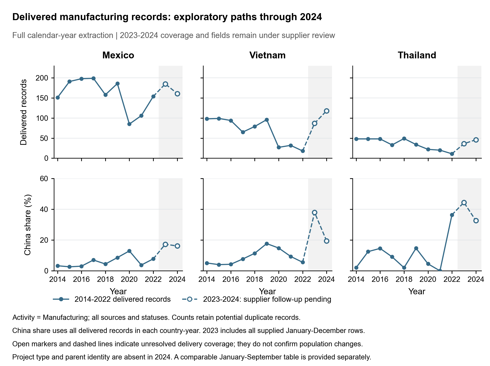

**已有数据的研究基线与下一项检验**

2026-10-03。本次工作服务于 Gate 2 的描述性证据和 Gate 3 的可观测目标准备。当前先整理事实、核对经济对象和选择一个数据支持的最小试点；疫情保留为时间分期与解释边界，详细因果识别另行开展。

已完成两项工作：将当前 fDi 数据转换为年度和分阶段事实，并按最新要求将共同字段的探索趋势延伸至 2024 年；提取已有 AMNE、BEA、ICIO 的具体 MP 候选指标，并检查原生行业对应、披露情况和分母。2023—2024 年保留全部交付记录，用不同标记展示，不必等供应商补齐才观察趋势。新文件独立保存，原始数据与上一版事实保留。

**一 先把三个调整维度固定为可复核事实**

fDi 样本为墨西哥、越南、泰国的 Manufacturing 活动，保留全部来源及交付记录。核心字段齐备的 2014—2022 年共有 2,349 条；共同字段的探索表进一步加入 2023 年 308 条、2024 年 325 条，合计 2,982 条。数量用固定年份范围计算，份额使用同一范围内的记录分母。当前单位为项目记录，不当作唯一企业或实际投产数量。下面的类型分期保持到 2022 年，数量和来源趋势延伸至 2024 年。

| 目的地 | 年均记录数 2014—2017 / 2018—2019 / 2020—2022 | Expansion 份额 三阶段 | 中国来源份额 三阶段 |
| --- | --- | --- | --- |
| 墨西哥 | 184.75 / 172.00 / 115.00 | 37.35% / 48.26% / 51.01% | 4.06% / 6.69% / 7.83% |
| 越南 | 89.00 / 87.50 / 25.67 | 18.82% / 24.57% / 31.17% | 5.06% / 14.86% / 10.39% |
| 泰国 | 44.25 / 41.50 / 17.67 | 41.24% / 45.78% / 39.62% | 9.60% / 7.23% / 9.43% |

这张表固定了两个需要分别解释的现象：项目数量的路径与构成变化不同；来源构成和新建/扩建构成也不能相互替代。墨西哥扩建份额在 2018—2019 年已明显高于基期；越南中国来源份额在 2018—2019 年高于 2020—2022 年。现阶段据此描述时间路径，不赋予政策或疫情的因果解释。

[2014—2024 趋势图 PDF](exploratory_annual_paths_2014_2024.pdf) · [完整探索年度表](exploratory_annual_full_year.csv) · [原2014—2022类型与来源图](staged_annual_paths.pdf) · [分阶段数据](staged_period_full_year.csv) · [阶段间变化](staged_period_changes_full_year.csv)

**二 把母公司历史匹配也扩展为两个阶段**

固定以 2014—2017 年为基期，精确匹配来源国、规范化后的母公司名和东道国，再分别查看 2018—2019 与 2020—2022 年。下表只报告正向历史匹配组；未匹配不解释为首次进入。

| 目的地 | 后期阶段 | 同母公司组合中 New / 全部记录 | New 份额 | 再要求同原生行业 New / 全部记录 |
| --- | --- | --- | --- | --- |
| 墨西哥 | 2018-2019 | 38 / 116 | 32.76% | 36 / 108（33.33%） |
| 墨西哥 | 2020-2022 | 28 / 107 | 26.17% | 21 / 96（21.88%） |
| 越南 | 2018-2019 | 23 / 44 | 52.27% | 14 / 28（50.00%） |
| 越南 | 2020-2022 | 13 / 25 | 52.00% | 9 / 20（45.00%） |
| 泰国 | 2018-2019 | 6 / 20 | 30.00% | 5 / 16（31.25%） |
| 泰国 | 2020-2022 | 4 / 11 | 36.36% | 3 / 9（33.33%） |

已有母公司名称组合内的新建项目在两个后期阶段均可观察到。它使“持续联系内部也可能有新建项目”这一解释更具体；仍不把名称历史当作持续在营证明，也不把 New 当作首次企业进入。与原有 F04 的关系是解释补充，尚未建立项目与 AMNE 行业产出之间的逐一对应。

[分阶段母公司历史表](staged_parent_history.csv)

**三 直接观察 2023 和 2024 年的交付趋势**

2023 年使用年内全部交付记录，包括有覆盖疑点的第四季度；2024 年使用八字段工作表的全部交付记录。共有日期、来源国、目的国、行业和活动等字段可以继续比较，所以记录数与来源份额直接延伸到 2024 年。

| 目的地 | 年内记录数 2022 / 2023 / 2024 | 其中中国来源记录数 三年 | 中国来源份额 三年 |
| --- | --- | --- | --- |
| 墨西哥 | 154 / 185 / 161 | 12 / 32 / 26 | 7.79% / 17.30% / 16.15% |
| 越南 | 18 / 87 / 118 | 1 / 33 / 23 | 5.56% / 37.93% / 19.49% |
| 泰国 | 11 / 36 / 46 | 4 / 16 / 15 | 36.36% / 44.44% / 32.61% |

当前样本中，越南、泰国的总记录数在 2024 年继续增加，墨西哥低于 2023 年；三国中国来源记录数均低于 2023 年，中国来源份额也均下降。越南 Other East Asia（日本、韩国、台湾）的记录由 2023 年 24 条增至 2024 年 55 条，对应份额 27.59% → 46.61%。因此，交付数据中的后续总量恢复与中国来源持续扩张不是同一个事实。这是待供应商修复后重算的初步观察，不据此认定总体投资的确定变化。

月份窗口会影响部分判断。下面把两年都限定为 1—9 月；墨西哥中国来源份额的变化方向与全年记录相反，因此不能把“墨西哥中国来源份额已经转降”作为当前稳健事实。越南和泰国的方向在两个窗口中一致，但仍属于交付样本的描述。

| 目的地 | 全年中国来源份额 2023 → 2024 | 同1—9月中国来源份额 2023 → 2024 | 同1—9月记录数 2023 → 2024 |
| --- | --- | --- | --- |
| 墨西哥 | 17.30% → 16.15% | 14.20% → 17.78% | 162 → 135 |
| 越南 | 37.93% → 19.49% | 34.85% → 21.88% | 66 → 96 |
| 泰国 | 44.44% → 32.61% | 42.31% → 32.43% | 26 → 37 |

类型字段单独处理：2023 年墨西哥、越南、泰国分别有 173/185、75/87、35/36 条记录可观察 Project_Type；已知类型子样本的 Expansion 份额分别为 49.13%、21.33%、8.57%，不能称为无缺失的全年类型份额。2024 年没有 Project_Type 和 Parent_Company，相关类型数量、份额与母公司匹配保留缺失；公司名称不替代母公司名称。

2024 年制造活动记录中存在按当前八个可见字段完全相同的候选组，若机械合并会减少 9 条；因项目地点和 Project ID 不可见，本次保留原始行。月度表的零表示本次交付没有该类记录，不证明总体没有投资。

[各年统一1—9月探索表（至2024）](exploratory_annual_jan_sep.csv) · [2023—2024月份及字段覆盖](exploratory_monthly_2023_2024.csv) · [月度来源国明细](exploratory_monthly_source_country_2023_2024.csv)。同月份表是辅助比较，不扩算全年。补充数据到齐后保留当前版本并按同一规则更新。

**四 现在开始准备一个小的 MP 检验**

以“美国母公司在墨西哥的生产”为候选范围，检查汽车、电子、机械三个制造部门。选择规则是行业对应与数据披露，而不是某个部门是否呈现更大的增长。三个部门及其不适用原因均保留。

| 候选部门 | 现有资料检查所得 | 当前用途 |
| --- | --- | --- |
| 汽车 | BEA 的 Transportation equipment 比 AMNE 汽车行业更宽；现有对应标为混合行业且没有可信分配权重 | 保留原生口径参照，不能直接作为严格汽车部门的跨来源配对 |
| 电子 | BEA 资本支出存在披露抑制；出口货物指标与 sales 的比率出现大于1的单元 | 保留公开值和抑制标识；相关比率不直接作为目的地销售概率 |
| 机械 | 候选的行业对应和披露条件相对完整 | 作为优先检验对象；指标定义、年份和分母见下列准备说明 |

已提取 315 行候选指标和 90 行同来源端点变化，原始行业、分母、单位、披露及角色逐项保留。机械的首个拟合候选为美国母公司在墨西哥 C28 的直接外资产出占墨西哥同年 C28 全部 gross output 的份额；分母包含本国与外国生产者。

| 年份 | AMNE 美国母公司机械产出（当期百万美元） | 占墨西哥全部机械产出的份额 | BEA 美国母公司机械销售（当期百万美元） |
| --- | --- | --- | --- |
| 2017 | 6,698.19 | 20.83% | 7,971.00 |
| 2019 | 6,201.23 | 19.06% | 6,480.00 |
| 2022 | 8,397.59 | 20.72% | 9,699.00 |

2017—2022 年美国母公司机械产出的名义规模增加，但它占东道国全部机械产出的份额基本持平。这是选择份额与水平两个诊断维度的实际理由，不能由名义产出增长直接断言 MP 成本下降。BEA 销售与 AMNE 产出并列用于诊断，未当作同一统计量。

[MP 试点准备说明](../mp_pilot_prepare_2026_10_03/READY_NEXT_TEST.md) · [315行可观测指标](../mp_pilot_prepare_2026_10_03/observable_targets.csv) · [同来源端点变化](../mp_pilot_prepare_2026_10_03/same_source_endpoint_changes.csv)。这一步得到可核对的候选指标，不把数据变化直接换算为 hgamma。

下一项模型工作应限制为一个清楚的成本变化对象：美国母公司通过墨西哥机械行业生产的有效 MP 成本变化。先固定有依据的弹性及其他冲击，确定一个与模型生产份额严格对应的 AMNE 目标，再把其产出水平与 BEA 经营指标作为额外诊断；不同时自由估计成本变化和弹性。若分母、三边网络或基准会计仍未对应，先完成这些映射，再拟合参数。

合格标准是：数据口径能对应模型对象；参数变化确实通过声明的渠道改变生产配置；拟合结果不只机械命中一个目标，还能接受其他经营指标的检验。若目标与辅助指标冲突，应报告冲突或调整模型，不能通过挑选行业、填零或随意设置 hgamma 消除。当前尚未完成这个结构拟合，也未产生福利估计。

**当前工作顺序**

| 顺序 | 具体工作 | 产出 |
| --- | --- | --- |
| 已完成 | 整理年度、分阶段、同月份与母公司历史 facts | 本目录 CSV、图形、独立复算记录 |
| 已完成 | 检查现有 AMNE、BEA、ICIO 可观测目标与候选部门 | MP准备说明、数值目标表、披露和映射诊断 |
| 下一步 | 对机械试点完成模型目标分母和网络限制的对应，再做低维匹配检验 | 有定义、可解释的校准试算或明确的失败原因 |
| 收到供应商补充后 | 核验记录完整性、稳定ID、类型及分类后，更新同一事实流程 | 可与当前基线逐项对照的新版本 |
| 详细识别阶段 | 结合政策暴露与其他冲击区分经济原因 | 因果识别及相应稳健性，不作为当前描述整理的前置条件 |

这里的分阶段处理只是保持描述透明，不把疫情问题扩展成当前独立研究任务。当前仍可完成数据对齐、事实整理和模型目标准备。

[分阶段独立数值审核](STAGED_INDEPENDENT_REVIEW.json) · [延伸至2024的独立审核](EXPLORATORY_INDEPENDENT_REVIEW.json) · [探索数据方法](EXPLORATORY_METHOD.json) · [探索图形审核](EXPLORATORY_FIGURE_REVIEW.json) · [本阶段范围及解释检查](RESEARCH_SCOPE.json)
